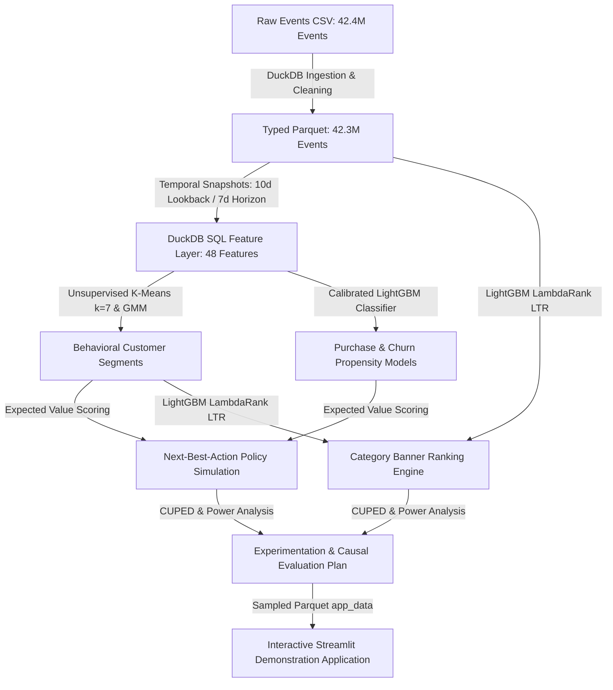
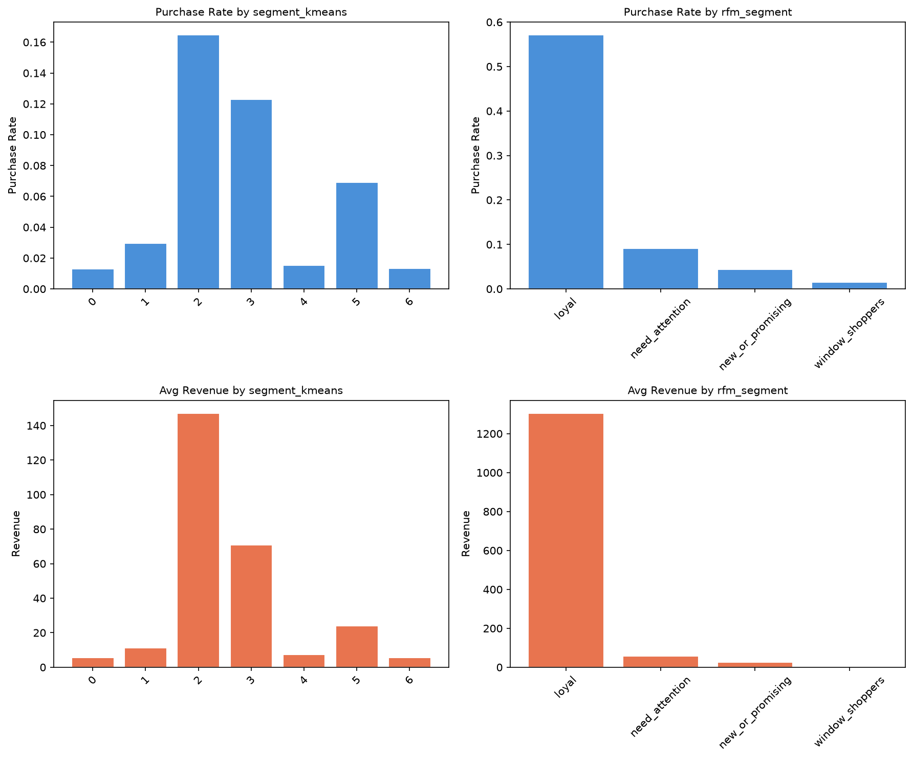
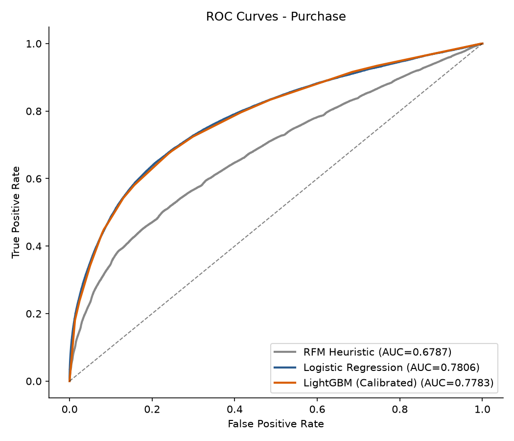
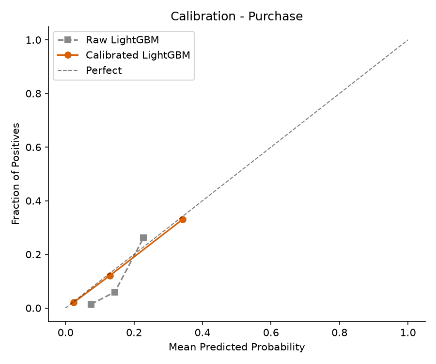
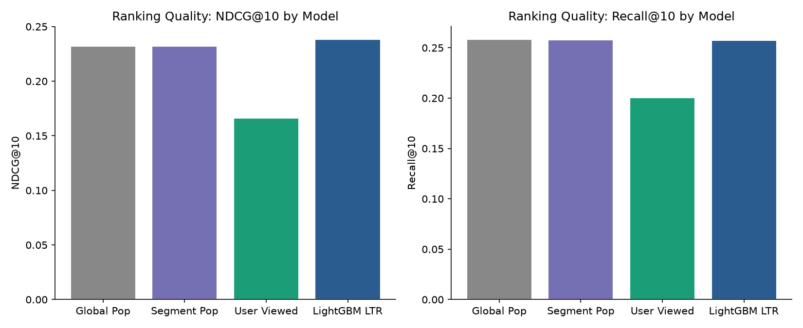
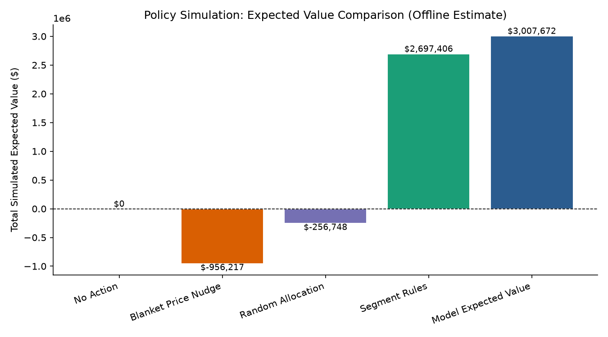
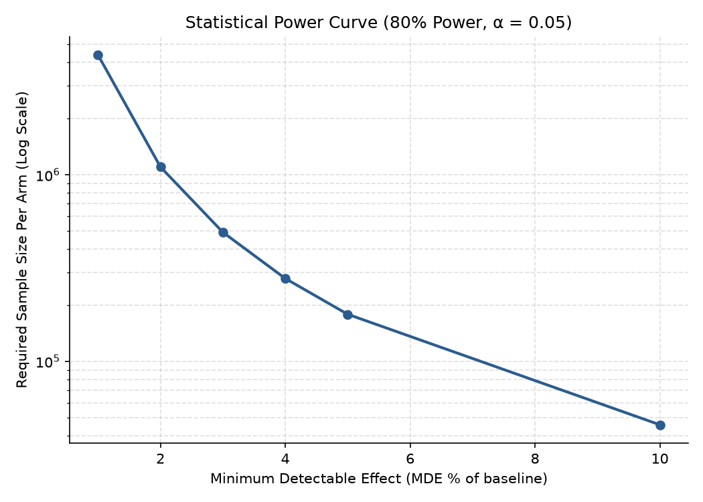

# Customer Segmentation, Next-Best-Action & Banner Ranking Engine

[](https://github.com/okBhavya/Customer-Segmentation/actions/workflows/ci.yml)
[](https://www.python.org/)
[](LICENSE)
[](https://github.com/astral-sh/ruff)

An end-to-end customer intelligence, personalization, and decisioning engine built on 42.4M eCommerce behavioral events. The platform unifies behavioral customer segmentation, calibrated purchase and churn propensity modeling, offline next-best-action (NBA) policy simulation, Learning-to-Rank category banner personalization with counterfactual Inverse Propensity Scoring (SNIPS), and causal experiment design with CUPED variance reduction.

---

## Architecture & Data Flow



---

## Dataset

- **Source**: REES46 eCommerce behavior data from multi-category store on [Kaggle](https://www.kaggle.com/datasets/mkechinov/ecommerce-behavior-data-from-multi-category-store), file `2019-Oct.csv`.
- **License**: Open Data / CC0 Public Domain. Data is not redistributed in this repository; ingestion downloads or reads the local raw CSV directly.
- **Volume**: 42,448,764 raw rows across October 2019 (100% October calendar month).
- **Entities**: 3,021,435 unique users, 165,647 products across 239 category banners.

---

## Key Experimental Results

All reported figures are produced by code executed on the real full dataset and are fully traceable to [`reports/metrics.json`](reports/metrics.json).

### 1. Data Cleaning & Profile

| Metric | Value |
|---|---|
| Raw Events Processed | 42,448,764 |
| Deduplicated Valid Events | 42,349,874 |
| Exact Duplicate Rows Dropped | 30,220 |
| Invalid Prices Filtered (`price <= 0`) | 68,673 |
| Unique Users Processed | 3,021,435 |
| Unique Catalog Items | 165,647 |
| Ingestion Pipeline Runtime | 297.5s (4.9 min) |

### 2. Behavioral Customer Segmentation ($k=7$)

Unsupervised clustering on 14 log-transformed, standardized behavioral features identified 7 stable customer archetypes, evaluated out-of-time on the held-out **Test Snapshot** (1,457,672 users):

| Cluster ID | Segment Name | User Share | Test Count | Lookback Avg Spend | Forward Purchase Rate (95% CI) | Forward Churn Rate | Test Revenue Share |
|---|---|---|---|---|---|---|---|
| **Cluster 2** | Power Buyers (Cart & Checkout) | 6.36% | 92,745 | $691.83 | 16.48% [16.24%, 16.72%] | 51.96% | **47.43%** |
| **Cluster 3** | Direct 1-Click Purchasers | 3.18% | 46,377 | $350.37 | 12.28% [11.98%, 12.58%] | 55.20% | **11.39%** |
| **Cluster 5** | Catalog Explorers (Heavy Browsers) | 7.84% | 114,281 | $9.50 | 6.90% [6.76%, 7.05%] | **35.29%** | 9.57% |
| **Cluster 1** | Deep Comparison Shoppers | 21.82% | 318,045 | $0.00 | 2.97% [2.91%, 3.02%] | 56.60% | 12.54% |
| **Cluster 4** | Recent Casual Visitors | 24.56% | 357,999 | $0.01 | 1.52% [1.48%, 1.56%] | 64.14% | 9.02% |
| **Cluster 6** | Mid-Recency Bouncers | 13.69% | 199,579 | $0.07 | 1.34% [1.29%, 1.39%] | 67.72% | 3.81% |
| **Cluster 0** | Dormant Window Shoppers | 22.55% | 328,646 | $0.02 | 1.28% [1.25%, 1.32%] | 71.96% | 6.23% |

*Variance Explained*: K-Means behavioral segments explain **$5.03\%$ of forward purchase variance ($R^2 = 0.0503$)**, providing a **$5.5\times$ predictive lift** over standard RFM rule partitions ($R^2 = 0.0091$).

### 3. Predictive Propensity Models (Test Snapshot)

Evaluated out-of-sample on the Test Snapshot (Oct 15–24 lookback, Oct 25–31 forward horizon; purchase base rate = 3.47%, churn base rate = 58.74%):

| Target | Model | ROC-AUC | PR-AUC | Log-Loss | Brier Score | Difference vs Baseline (95% CI) |
|---|---|---|---|---|---|---|
| **Purchase (7-Day)** | RFM Heuristic | 0.6787 | 0.1092 | 0.1969 | 0.0429 | Baseline |
| **Purchase (7-Day)** | Regularized Logistic Regression | 0.7806 | 0.2096 | 0.5653 | 0.1850 | +0.1019 [0.0984, 0.1054] |
| **Purchase (7-Day)** | LightGBM (Raw) | 0.7785 | 0.1586 | 0.1673 | 0.0356 | +0.0998 [0.0963, 0.1033] |
| **Purchase (7-Day)** | **LightGBM (Calibrated Sigmoid)** | **0.7783** | **0.1569** | **0.1292** | **0.0309** | **+0.0996 [0.0961, 0.1031]** |
| **Churn (7-Day)** | RFM Heuristic | 0.5189 | 0.5473 | 1.4421 | 0.2847 | Baseline |
| **Churn (7-Day)** | Regularized Logistic Regression | 0.6748 | 0.6698 | 0.6408 | 0.2248 | +0.1559 [0.1521, 0.1597] |
| **Churn (7-Day)** | **LightGBM (Calibrated Isotonic)** | **0.6823** | **0.6794** | **0.6348** | **0.2217** | **+0.1634 [0.1596, 0.1672]** |

*Note on Calibration*: While raw trees yield high separation, probability calibration reduces purchase Brier score from 0.0356 to **0.0309** and log-loss from 0.1673 to **0.1292**, providing reliable probability inputs for expected-value decisioning.

### 4. Category Banner Ranking & Counterfactual Evaluation

Banner units represent 239 category-level promotional slots. Relevance is graded hierarchically (purchase=3, cart=2, view=1):

| Model Policy | NDCG@10 | Recall@10 | HitRate@10 | Catalog Coverage | Cold-Start NDCG |
|---|---|---|---|---|---|
| Global Popularity | 0.2322 | 0.2582 | 0.2649 | 100.0% | 0.2094 |
| Segment Popularity | 0.2319 | 0.2580 | 0.2649 | 100.0% | 0.2093 |
| User Most Viewed | 0.1660 | 0.2004 | 0.2346 | 100.0% | 0.1479 |
| **LightGBM LambdaRank** | **0.2382** | **0.2576** | **0.2649** | **100.0%** | **0.2136** |

- **Relative Uplift**: LightGBM LambdaRank improves NDCG@10 over Global Popularity by **+2.58%** (Bootstrap 95% CI: `[+2.04%, +3.18%]`).
- **Counterfactual CTR Proxy (SNIPS)**: Under Self-Normalized Inverse Propensity Scoring (weight clipping min 0.05), the estimated CTR proxy is **0.04796** (95% CI: `[0.04651, 0.04957]`), adjusting for observational popularity and exposure bias compared to the naive click rate of 0.07171.

### 5. Next-Best-Action Policy Simulation (Test Snapshot)

Simulating 6 candidate interventions on 1,457,672 test snapshot users under stated marginal costs and uplift assumptions:

| Decision Policy | Total Marginal Cost | Total Simulated EV | Avg EV / User | Interventions Dispatched |
|---|---|---|---|---|
| `no_action` (Control) | $0.00 | $0.00 | $0.0000 | 0 |
| `blanket_price_nudge` (100% treatment) | $1,457,672.00 | -$956,217.18 | -$0.6560 | 1,457,672 |
| `random_allocation` | $758,235.05 | -$256,748.25 | -$0.1761 | 1,457,672 |
| `segment_rules` (Heuristic) | $983,577.20 | $2,697,406.06 | $1.8505 | 1,457,672 |
| **`model_expected_value` (Optimized)** | **$1,023,263.65** | **$3,007,672.07** | **$2.0633** | **1,398,707** |

The Model Expected Value policy delivers **+$310,266.01 net incremental simulated value** over segment heuristics by dynamically suppressing treatments for users whose expected lift does not cover marginal contact costs.

### 6. Causal Experimentation & Power Sizing

Using the real baseline purchase conversion rate ($3.47\%$) and revenue distribution ($\mu = \$19.75, \sigma = \$269.03$):

| Relative MDE | Absolute MDE | Required Sample / Arm ($\alpha=0.05, \text{Power}=0.80$) | Total Required Sample (2 Arms) |
|---|---|---|---|
| **1.0%** | +0.035% | 4,384,219 users | 8,768,438 users |
| **2.0%** | +0.069% | 1,101,290 users | 2,202,580 users |
| **3.0%** | +0.104% | 491,783 users | 983,566 users |
| **5.0%** | +0.174% | 178,706 users | 357,412 users |
| **10.0%** | +0.347% | 45,707 users | 91,414 users |

- **CUPED Variance Reduction**: Pre-period lookback spend correlates with post-period revenue at $\rho = 0.4136$, delivering a **17.11% variance reduction** and an **effective sample size multiplier of 1.21x** (shortening experiment runtime by ~17%).
- **Simulation Verification**: Monte Carlo simulation (1,000 runs) confirms the empirical Type I error rate matches target $\alpha$ (**0.0580** vs 0.05) and empirical power matches target 80% (**0.8030** vs 0.80).

---

## Visualizations

### Behavioral Segment Outcomes & Churn Risk


### Purchase Propensity ROC & Calibration



### Banner Ranking NDCG@10 Comparison


### Next-Best-Action Expected Value Policy Simulation


### Statistical Power & MDE Curve


---

## Repository Layout

```text
Customer-Segmentation/
├── .github/workflows/
│   └── ci.yml                     # Continuous integration: ruff and pytest matrix (3.11, 3.12)
├── configs/
│   └── default.yaml               # Centralized dates, hyperparameters, paths, and seeds
├── data/                          # Ignored in git (never committed)
│   ├── raw/                       # Raw 2019-Oct.csv from Kaggle
│   └── processed/                 # DuckDB Parquet and snapshot features
├── docs/
│   ├── methodology.md             # Feature dictionary (50+ features) and leakage design
│   ├── segments.md                # Segment profiles, economics, and migration dynamics
│   ├── intervention_framework.md  # Action catalogue, unit economics, and segment playbooks
│   └── experiment_plan.md         # A/B design, SRM, CUPED, and multiple-testing corrections
├── notebooks/
│   └── 01_eda.ipynb               # Fully executed exploratory analysis notebook
├── reports/
│   ├── figures/                   # Generated evaluation charts and plots
│   ├── data_profile.json          # Data quality profile and ingest log
│   ├── feature_summary.json       # Feature counts and class balances per snapshot
│   ├── funnel_report.json         # Funnel conversion rates and opportunity sizing
│   ├── segment_metrics.json       # Cluster k-selection, ARI stability, and migration
│   ├── segment_profiles.json      # Profiling metrics per cluster
│   ├── propensity_metrics.json    # Propensity scorecards, deciles, and bootstrap CIs
│   ├── ranking_metrics.json       # NDCG@10, Recall@10, and SNIPS CTR proxy
│   ├── nba_report.json            # Policy simulation and sensitivity matrix
│   ├── experiment_report.json     # Sample size table, CUPED, and simulation stats
│   ├── runtimes.json              # Per-stage execution duration log
│   └── metrics.json               # Master consolidated JSON report
├── app/
│   └── app.py                     # Streamlit multi-page interactive portfolio app
├── app_data/                      # Committed compact sample dataset (1.36 MB <= 15 MB)
│   ├── sampled_users.parquet      # 20k stratified sampled users for app interactivity
│   ├── sample_rankings.parquet    # Top-k category ranking predictions
│   ├── figures/                   # Application assets
│   └── *.json                     # Copied summary reports
├── scripts/
│   ├── create_eda_notebook.py     # Reproducible notebook generator
│   └── generate_metrics_table.py  # Markdown metrics table formatter
├── sql/
│   └── features.sql               # Parameterized DuckDB SQL feature engineering query
├── src/custintel/
│   ├── __init__.py
│   ├── __main__.py                # Single CLI interface: python -m custintel <stage>
│   ├── config.py                  # YAML config loader and root locator
│   ├── db.py                      # DuckDB memory and thread connection manager
│   ├── ingest.py                  # Chunked CSV to typed Parquet ingestion
│   ├── features.py                # Temporal snapshot feature engineering
│   ├── funnel.py                  # Funnel and abandonment analysis
│   ├── segment.py                 # RFM baseline and K-Means/GMM clustering
│   ├── propensity.py              # Calibrated LightGBM classifiers and evaluation
│   ├── ranking.py                 # LightGBM LambdaRank and SNIPS counterfactual proxy
│   ├── nba.py                     # Action eligibility and expected value simulation
│   ├── experiment.py              # CUPED, SRM, and power calculations
│   └── app_data.py                # Compact app_data bundle packaging
├── tests/
│   ├── fixtures/
│   │   ├── generate_smoke_data.py # Synthetic events generator
│   │   └── smoke_events.csv       # Small synthetic dataset for CI
│   ├── test_audit.py              # Leakage audit and SQL vs pandas cross-checks
│   ├── test_cli_smoke.py          # End-to-end pipeline integration on synthetic data
│   ├── test_experiment.py         # CUPED, SRM, and power vs statsmodels
│   ├── test_features.py           # SQL feature logic vs hand-computed fixtures
│   ├── test_nba.py                # NBA eligibility and EV calculation math
│   ├── test_pipeline_edges.py     # Edge cases: empty segments, nulls, IPS clipping
│   ├── test_propensity.py         # Scikit-learn score cross-checks and bootstrap CIs
│   ├── test_ranking.py            # Hand-computed NDCG@k and bandit IPS validation
│   └── test_segmentation.py       # Zero-inflated RFM and K-Means determinism
├── LICENSE                        # MIT License (Bhavya Gupta)
├── Makefile                       # Unified make task runner
├── pyproject.toml                 # Package definition and tool configs
└── requirements.txt               # Direct dependencies with pinned versions
```

---

## Stage Execution & Runtimes

All stages run sequentially via `make all` or individually via `python -m custintel <stage>`:

| Stage | Command | Runtime | Key Output |
|---|---|---|---|
| Ingest | `python -m custintel ingest` | 297.5s (4.9m) | `events.parquet`, `data_profile.json` |
| Features | `python -m custintel features` | 165.0s (2.7m) | `*_features.parquet`, `feature_summary.json` |
| Funnel | `python -m custintel funnel` | 120.0s (2.0m) | `funnel_report.json`, opportunity ranking |
| Segment | `python -m custintel segment` | 171.6s (2.9m) | `*_segments.parquet`, `segment_metrics.json` |
| Propensity | `python -m custintel propensity` | 365.4s (6.1m) | Calibrated models, `propensity_metrics.json` |
| Rank | `python -m custintel rank` | 242.2s (4.0m) | LambdaRank ranker, `ranking_metrics.json` |
| NBA | `python -m custintel nba` | 25.6s (0.4m) | `nba_report.json`, policy simulations |
| Experiment | `python -m custintel experiment` | 5.2s (0.1m) | CUPED reduction, `experiment_report.json` |
| App Data | `python -m custintel app-data` | 2.3s (0.05m) | `app_data/` bundle (1.36 MB) |
| **Total Pipeline** | **`make all`** | **1,394.8s (~23.2m)** | Full end-to-end pipeline completion |

---

## Quickstart & Reproducibility

### 1. Environment Setup

```bash
# Clone the repository
git clone https://github.com/okBhavya/Customer-Segmentation.git
cd Customer-Segmentation

# Create virtual environment (Python >= 3.10)
python -m venv .venv

# Activate environment (Windows PowerShell)
.\.venv\Scripts\Activate.ps1
# On Linux/macOS: source .venv/bin/activate

# Install dependencies and local package in editable mode
pip install --upgrade pip
pip install -r requirements.txt
pip install -e .
```

### 2. Run Smoke Test Suite (No Dataset Required)

The smoke test runs the full pipeline end-to-end on synthetic data fixtures in seconds:

```bash
# Execute end-to-end smoke test
python -m custintel all --smoke

# Run the complete test suite with coverage
pytest --cov=custintel --cov-report=term-missing
```

### 3. Run Production Pipeline (Requires Kaggle Dataset)

Place `2019-Oct.csv` in `data/raw/` and run:

```bash
# Run entire pipeline from raw CSV to app data
make all

# Launch the interactive Streamlit demonstration application
make app
# Or directly:
streamlit run app/app.py
```

---

## Design Decisions & Assumptions

1. **Absence of Banner Impression Logs**:
   The REES46 dataset does not record onsite banner impressions or display logs. Category banners are therefore modelled as category-level promotional slots, and the ranking task is formulated as predicting which categories a customer engages with over the subsequent 7 days.
2. **Absence of Intervention Logs**:
   No marketing treatments or A/B test logs exist in the observational dataset. All Next-Best-Action comparisons represent **simulated offline expected-value estimates** under documented unit cost and uplift assumptions. They are never framed as measured experimental lift.
3. **Leakage-Free Temporal Windows**:
   Snapshots enforce disjoint label horizons. Features use only events strictly before the snapshot cut-off; labels use only events strictly after. Scalers, clusterers, and calibrated models are fit strictly on the training snapshot and evaluated out-of-time.
4. **Counterfactual Evaluation with SNIPS**:
   Because observational click logs are confounded by item popularity, offline ranking evaluation applies **Self-Normalized Inverse Propensity Scoring (SNIPS)** with propensity clipping at 0.05 to guard against weight explosion.
5. **Zero-Inflated Monetary Handling**:
   More than 80% of window users have zero spend. To prevent quantile binning failures (`qcut`), the RFM baseline explicitly isolates zero spend as rank 0 before quartile-binning non-zero purchasers.

---

## How This Was Built & Validated

This project was developed by pairing data science and ML engineering principles with AI assistance (Google Antigravity powered by Gemini 3.8 Flash). 

To ensure absolute methodological and computational integrity, all AI-generated code and statistical findings were subjected to rigorous independent validation:
- **Comprehensive Unit Testing**: 37 unit tests covering edge cases, math proofs, and integration flows.
- **Independent Cross-Checks**: Key SQL features were independently re-implemented in pure pandas on randomized user samples to verify bitwise equality.
- **Leakage Audits**: Verified that removing all events post-snapshot produces identical feature vectors, and confirmed shuffled-label classifiers collapse to AUC ~ 0.50.
- **Statistical Benchmarking**: Statistical power and MDE calculations were cross-checked directly against `statsmodels.stats.power.NormalIndPower`.
- **Determinism**: Fixed random seeds across LightGBM, scikit-learn, and DuckDB ensure all metrics, bootstrap intervals, and cluster assignments reproduce exactly.
